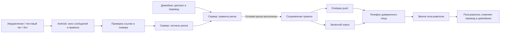

<div align="center">

# 🛡️ SENIM

### Защита начинается с доверия

**Прототип помощника для защиты клиентов банков и их близких от телефонного и интернет-мошенничества**

`Финтех` · `Антифрод` · `Кибербезопасность` · `Доверенное лицо`

**Автор проекта:** Акимов Алимжан Абзалович

</div>

---

## 💡 Идея проекта

Мошенническая история часто начинается задолго до перевода: с сообщения от якобы родственника, подозрительной ссылки или звонка от человека, представляющегося сотрудником банка. Под давлением и в спешке пользователю бывает трудно остановиться и проверить происходящее.

**Senim объединяет техническое предупреждение с человеческой поддержкой.** Приложение помогает заметить подозрительный контакт, а сервер демобанка оценивает контекст операции. При определённых условиях выбранное доверенное лицо получает тревогу и может связаться с пользователем.

> Senim не принимает решение за человека. Его задача — помочь вовремя заметить риск, сделать паузу и обратиться к тому, кому доверяют.

## 🎯 Актуальность

Мошеннические сообщения и звонки могут имитировать общение с родственниками, представителями банков и других организаций. Проверка только номера, ссылки или суммы по отдельности не всегда объясняет пользователю общую картину.

Senim рассматривает безопасность как последовательность: **контакт → предупреждение → контекст операции → поддержка близкого**. Это соответствует тематике антифрода, защиты клиентов и кибербезопасности в финтехе.

## ✨ В чём новизна Senim

Новизна проекта — **в сочетании механизмов в одном сценарии**, а не в утверждении, что каждая технология создана впервые:

1. **Контекст вместо одного сигнала.** В демобанке сервер сопоставляет закрытие депозита, нового получателя и сумму перевода. Предшествующий сигнал риска может снизить порог суммы.
2. **Человек рядом в нужный момент.** Выбранное доверенное лицо получает тревогу и может позвонить пользователю, чтобы помочь проверить ситуацию.
3. **Решение остаётся за пользователем.** По замыслу близкий получает уведомление, а не право распоряжаться деньгами; отмену в демобанке выполняет пользователь.
4. **Сначала предупреждение, затем контекст.** Подозрительная ссылка или номер предупреждают пользователя и могут учитываться как сигнал риска; сами по себе они не создают тревогу о переводе.
5. **Запасной путь получения тревоги.** Push дополняется опросом сервера для получения сохранённых тревог, если уведомление не пришло.
6. **Код-приманка.** Специальный демонстрационный код не подтверждает платёж, а попытка его использования в Senim создаёт тревогу.
7. **Приватность переписки.** По архитектуре текст анализируется на телефоне, а сервер получает признаки и необходимые для проверки данные, а не содержимое переписки.

Проверка сообщений, доверенные контакты и другие отдельные элементы уже встречаются в существующих продуктах. Senim предлагает их сочетание и адаптацию к понятному пользовательскому сценарию; его уникальность и эффективность ещё требуют исследования и испытаний.

## 👥 Для кого и какая польза

| Участник | Возможная польза |
|---|---|
| **Клиент банка** | Получает предупреждение и повод остановиться, прежде чем действовать под давлением. |
| **Доверенное лицо** | Может получить сигнал и связаться с близким, чтобы помочь проверить ситуацию. |
| **Банк — потенциальный партнёр** | Может оценить сценарий дополнительной поддержки клиента при подозрительной операции. |
| **Семья** | Получает понятную идею взаимодействия: заметить риск, поговорить и вместе проверить информацию. |

## ⚙️ Возможности Senim

### 🔗 Проверка ссылок

Приложение извлекает ссылки из доступных источников и отправляет нормализованный адрес на проверку. Сервер использует демонстрационные признаки опасных доменов и сокращённых ссылок и возвращает причины предупреждения. «Привратник» задуман как промежуточный экран перед переходом; возможность его использования зависит от настроек и ограничений Android.

### ☎️ Проверка номеров и звонков

Номер приводится к согласованному формату и хешируется на телефоне. Сервер сверяет хеш с демонстрационной базой жалоб и учитывает признаки, рассчитанные на устройстве. В приложении предусмотрена отправка жалобы на подозрительный номер и код службы проверки входящего звонка. Действия с вызовами зависят от разрешений и конкретного устройства.

### 💬 Защита переписки

Уведомления, тестовый чат и сообщения тестового Telegram-бота приводятся к общей схеме обработки. На телефоне применяются правила для подозрительных фраз; архитектура предусматривает подключение локальной модели. **Обученная модель в текущий APK не включена.** Бот видит только сообщения, отправленные ему, а сторонние уведомления могут содержать не всю переписку.

### 🏦 Демобанк и правила риска

Демонстрационный банк показывает баланс и депозит, позволяет закрыть депозит, создать перевод и отменить его в установленное время. Сервер оценивает риск с учётом последовательности событий и, при выполнении правил, создаёт тревогу доверенному лицу. Суммы и сценарии — тестовые.

### 🔔 Тревога доверенному лицу

При рискованном сценарии сервер сохраняет тревогу и предусматривает отправку через Firebase Cloud Messaging. Приложение доверенного лица также может запрашивать сохранённые тревоги. Доставка push и работа запасного опроса зависят от сети, настроек устройства и состояния приложения.

### 🎭 Код-приманка

В демосценарии пользователь получает отдельный код, который не подтверждает платёж. При попытке использовать его через интерфейс Senim сервер создаёт тревогу. Ввод этого кода вне Senim приложение автоматически не видит.

### 📹 Памятка при видеозвонке

При обнаружении признаков входящего видеозвонка в доступном уведомлении приложение может показать советы: использовать семейное кодовое слово и самостоятельно перезвонить по известному номеру. Распознавание и хранение лиц проект не использует.

### 🧩 Дополнительные направления

- **Проверка файлов по хешу:** серверная часть сопоставляет демонстрационные хеши и признаки имени файла; проверка с телефона требует отдельной интеграции.
- **Офлайн-журнал:** серверная часть предусматривает резерв, проверку подписи и цепочки записей; полноценный обмен между телефонами по Bluetooth не подтверждён.
- **Анализ речи на устройстве:** концепция для демонстрационного сценария с согласием пользователя; её нельзя считать работающей функцией текущего APK.

Подробности и ограничения каждого направления: [Новизна проекта Senim](docs/NOVIZNA_SENIM.md).

## 🏗️ Архитектура



**Android-приложение** отвечает за интерфейс, доступные уведомления, проверку сообщений по правилам, запросы к серверу и отображение тревог.

**Сервер Senim** содержит API, демонстрационные данные SQLite, проверку ссылок и номеров, правила риска, демобанк и хранение тревог. Тревогу создаёт сервер.

**Firebase Cloud Messaging** используется как канал push-уведомлений. При наличии доступа приложение доверенного лица также может получить сохранённые тревоги через API.

**Принцип данных:** текст переписки по контракту не отправляется на сервер. Сервер может получать нормализованный URL, хеш номера, признаки, оценку и другие данные, предусмотренные API. Хеш номера не является гарантией анонимности.

## 🧪 Пример демонстрации

1. Пользователь получает тестовое сообщение с подозрительной ссылкой и видит предупреждение.
2. В демобанке пользователь закрывает депозит и создаёт перевод новому получателю.
3. Сервер сопоставляет события с настройками риска и формирует тревогу при выполнении условий.
4. Доверенное лицо получает тревогу и может связаться с пользователем.
5. Пользователь отменяет ожидающий перевод в демобанке.

Это сценарий прототипа, а не настоящая банковская операция. Для демонстрации необходимо заранее проверить все шаги на двух телефонах и подготовить запасное видео.

## 🛠️ Технологии

- **Android:** Kotlin, Jetpack Compose, Retrofit и Firebase Messaging.
- **Сервер:** Python 3.11, FastAPI и SQLite.
- **Уведомления:** Firebase Cloud Messaging и запасной опрос API.
- **Сеть:** HTTPS для размещённого демо-сервера.
- **Данные:** тестовые пользователи, счета и операции; деньги передаются целым числом в тенге.

## 📁 Структура репозитория

```text
Senim/
├── android/   Android-приложение и инструкция по сборке
├── server/    API, демобанк и правила риска
└── docs/      Описание новизны проекта
```

- [Инструкция по запуску сервера](server/README.md)
- [Инструкция по сборке Android](android/SENIM_SETUP.md)
- [Подробно о новизне и функциях](docs/NOVIZNA_SENIM.md)

## 🔐 Безопасность и границы прототипа

**Senim — демонстрационный проект, а не банковский продукт.** Реальные счета, государственные базы и реальные банковские операции не подключены. Для использования с настоящими пользователями необходимы интеграция с банком, персональная авторизация, разграничение прав, аудит безопасности, проверка согласий и требований к персональным данным.

Текущий API использует общий ключ для демо: человек с этим ключом может выполнять запросы от имени тестовых пользователей. Его нельзя помещать в GitHub, публичный APK или презентацию. Приватный ключ Firebase хранится отдельно от репозитория.

Прототип не гарантирует обнаружение всех видов мошенничества и может ошибаться. Подозрительный результат — повод проверить ситуацию, а не доказательство вины человека.

---

<div align="center">

**Senim — технологии, которые помогают вовремя связаться с теми, кому мы доверяем.**

</div>
